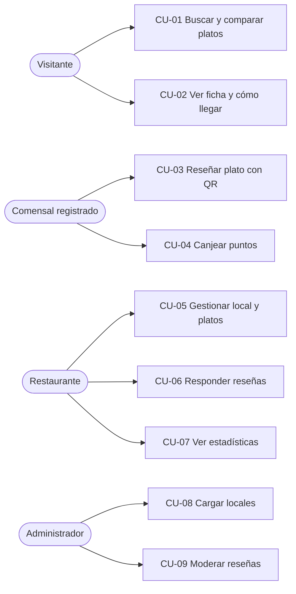
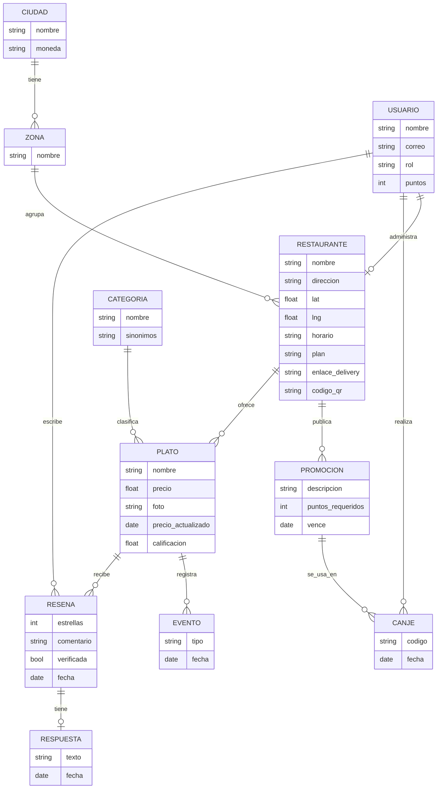

# Fase 5. Ingeniería de requisitos

Esta fase traduce el modelo de negocio validado ([Fase 3](03-modelo-de-negocio.md)) y los hallazgos de las encuestas ([Fase 4](04-validacion-en-tarija.md)) en requisitos concretos para construir el MVP. Cada requisito indica de dónde sale, para mantener la trazabilidad.

## 5.1 Objetivo y alcance del sistema

**Objetivo del MVP:** demostrar que un comensal puede encontrar en menos de 30 segundos el mejor plato cerca, y que un restaurante puede publicar sus platos y ver cuántas personas los vieron.

| Incluye | No incluye (por ahora) |
|---|---|
| Web/PWA para celular (sin instalar desde la tienda) | App nativa Android/iOS |
| Búsqueda, ranking y ficha de plato | Pedidos y pagos dentro de la app |
| Reseñas verificadas con QR y puntos | Cobro real de los planes (se simula la elección de plan) |
| Panel del restaurante con estadísticas | Varias ciudades (solo Tarija, aunque el modelo de datos ya lo soporta) |
| Carga manual de 20–30 locales por el equipo | Integración automática con PedidosYa / Yango (solo enlace) |

**Alcance inicial de datos:** ciudad de Tarija, zona cercana a las universidades, categoría principal hamburguesas (más algunas categorías de apoyo para mostrar la búsqueda por antojo).

## 5.2 Actores del sistema

| Actor | Descripción | Necesita cuenta |
|---|---|---|
| **Visitante** | Persona que busca y consulta platos | No |
| **Comensal registrado** | Visitante que inicia sesión para reseñar y acumular puntos | Sí |
| **Restaurante** | Dueño o administrador que gestiona su local, platos y reseñas | Sí |
| **Administrador** | Miembro del equipo que carga locales, modera reseñas y configura categorías | Sí |

## 5.3 Requisitos funcionales

**Prioridad (MoSCoW):** **M** = debe tener (sin esto no hay MVP) · **S** = debería tener · **C** = podría tener · **W** = no en esta versión.
**Origen:** P = problema del Lean Canvas · H = hipótesis · A = ajuste de la sección 4.6 · Pn = pregunta de la encuesta.

### Búsqueda y descubrimiento

| ID | Requisito | Actor | Prioridad | Origen |
|---|---|---|---|---|
| RF-01 | Buscar platos por nombre ("hamburguesa") o por categoría o antojo ("algo dulce", "comida típica") | Visitante | M | P1, H1, A6 |
| RF-02 | Mostrar resultados ordenados por un puntaje que combina calificación del plato y relación precio-calidad (ver RN-04) | Visitante | M | H2, A7 |
| RF-03 | Filtrar resultados por precio máximo y distancia | Visitante | M | P11 clientes |
| RF-04 | Filtrar por "abierto ahora", "con delivery" y tipo de dieta | Visitante | S | P11 clientes |
| RF-05 | Mostrar en cada resultado: plato, restaurante, distancia, precio, calificación y número de reseñas | Visitante | M | P2 |
| RF-06 | Mostrar un ranking "Top 5 de la semana" por categoría, para compartir en redes | Visitante | C | H4 |

### Ficha del plato y del restaurante

| ID | Requisito | Actor | Prioridad | Origen |
|---|---|---|---|---|
| RF-07 | Ver la ficha del plato: fotos, descripción, precio, calificación, reseñas y fecha de última actualización del precio | Visitante | M | P1, P2 |
| RF-08 | Botón "Cómo llegar" que abre la ubicación del local en el mapa | Visitante | M | Métrica clave |
| RF-09 | Botón "Pedir en PedidosYa / Yango" cuando el restaurante lo configure | Visitante | S | A8 |
| RF-10 | Ver el perfil del restaurante: dirección, horario, zona y menú completo | Visitante | M | P2 |

### Reseñas y puntos

| ID | Requisito | Actor | Prioridad | Origen |
|---|---|---|---|---|
| RF-11 | Registrarse e iniciar sesión con correo o cuenta de Google | Comensal | M | — |
| RF-12 | Calificar un plato de 1 a 5 estrellas, con comentario y foto opcionales | Comensal | M | H2 |
| RF-13 | Marcar la reseña como "Verificada" al escanear el QR del local | Comensal | M | A5 |
| RF-14 | Acumular puntos por cada reseña (ver RN-07) y ver el saldo | Comensal | S | H6, A4 |
| RF-15 | Canjear puntos por promociones publicadas por los restaurantes | Comensal | S | H6, A4 |
| RF-16 | Reportar una reseña inapropiada o un precio desactualizado | Comensal | C | Riesgos |

### Panel del restaurante

| ID | Requisito | Actor | Prioridad | Origen |
|---|---|---|---|---|
| RF-17 | Registrar el local: nombre, tipo, zona, dirección, ubicación en el mapa y horario | Restaurante | M | H3 |
| RF-18 | Crear, editar y eliminar platos: nombre, categoría, precio, foto y descripción | Restaurante | M | H3 |
| RF-19 | Responder públicamente a las reseñas de sus platos | Restaurante | M | A5, P8 restaurantes |
| RF-20 | Generar el QR del local para imprimirlo y ponerlo en las mesas | Restaurante | M | A5 |
| RF-21 | Ver estadísticas: vistas por plato, clics en "Cómo llegar" y "Pedir", y platos más buscados en su zona | Restaurante | M | P9 restaurantes |
| RF-22 | Crear promociones canjeables por puntos | Restaurante | S | A4 |
| RF-23 | Elegir plan (Básico, Básico+, Pro) y ver lo que incluye cada uno | Restaurante | C | A1, A2 |
| RF-24 | Configurar los enlaces a su tienda en PedidosYa o Yango | Restaurante | S | A8 |

### Administración

| ID | Requisito | Actor | Prioridad | Origen |
|---|---|---|---|---|
| RF-25 | Cargar locales y platos manualmente en nombre de un restaurante | Administrador | M | Riesgo de arranque en frío |
| RF-26 | Moderar reseñas reportadas (aprobar u ocultar) | Administrador | S | Riesgo de reseñas falsas |
| RF-27 | Gestionar ciudades, zonas y categorías | Administrador | C | Fase 7 (escalabilidad) |
| RF-28 | Mostrar espacios "Patrocinado" separados del ranking orgánico | Administrador | W | A3 |

## 5.4 Requisitos no funcionales

| ID | Tipo | Requisito | Origen |
|---|---|---|---|
| RNF-01 | Usabilidad | Un usuario nuevo encuentra un plato y su ubicación en menos de 30 segundos y en 3 toques como máximo | Persona Valentina |
| RNF-02 | Usabilidad | El panel del restaurante se puede usar sin capacitación técnica; cargar un plato toma menos de 2 minutos | P8 restaurantes ("no tengo tiempo o conocimiento") |
| RNF-03 | Compatibilidad | Diseño pensado primero para celular; funciona en Android de gama media y en los navegadores Chrome y Safari | Público universitario |
| RNF-04 | Rendimiento | Los resultados de búsqueda cargan en menos de 2 segundos con conexión 4G | Experiencia de uso |
| RNF-05 | Rendimiento | Las fotos se comprimen al subirlas para consumir pocos datos móviles | Uso con datos móviles |
| RNF-06 | Seguridad | Contraseñas cifradas, conexión HTTPS y cada restaurante solo puede editar su propio local | Buenas prácticas |
| RNF-07 | Privacidad | Se pide consentimiento para usar la ubicación; si se rechaza, el usuario elige su zona a mano | Confianza del usuario |
| RNF-08 | Confiabilidad | El restaurante no puede borrar ni editar reseñas de clientes | Regla de confianza (RN-01, RN-06) |
| RNF-09 | Escalabilidad | El modelo de datos incluye ciudad, zona y moneda, para abrir nuevas ciudades sin rehacer el sistema | Fase 7 |
| RNF-10 | Idioma | Interfaz en español, con textos preparados para traducirse | Fase 7 |
| RNF-11 | Mantenibilidad | Código en un repositorio con control de versiones y documentación de instalación | Trabajo en equipo |

## 5.5 Reglas de negocio

| ID | Regla |
|---|---|
| RN-01 | El ranking orgánico nunca se vende. Pagar solo da acceso a espacios marcados como "Patrocinado". |
| RN-02 | Un comensal puede reseñar el mismo plato como máximo una vez cada 30 días. |
| RN-03 | Una reseña verificada con QR pesa el doble en la calificación del plato que una no verificada. |
| RN-04 | **Puntaje del ranking** = 70 % calificación ajustada + 30 % índice de precio. La *calificación ajustada* evita que un plato con una sola reseña de 5 estrellas quede primero: se mezcla su promedio con el promedio de la categoría según cuántas reseñas tiene (promedio bayesiano, con un mínimo de 5 reseñas de referencia). El *índice de precio* compara el precio del plato con el de los demás platos de la misma categoría en la zona: más barato da más puntos. |
| RN-05 | Si el precio de un plato no se actualiza en 60 días, la ficha muestra "Precio sin confirmar". |
| RN-06 | El restaurante puede responder y reportar una reseña, pero no borrarla. |
| RN-07 | Puntos por reseña: 10 si es verificada y 3 si no lo es. Una foto suma 2 puntos más. |
| RN-08 | Límite de platos por plan: Básico 10, Básico+ 30, Pro ilimitado. |
| RN-09 | Un plato aparece en el ranking solo si tiene precio y al menos una foto. |

## 5.6 Historias de usuario

Formato: *Como [actor], quiero [acción], para [beneficio].* Los criterios de aceptación usan el formato *Dado / Cuando / Entonces*.

**HU-01. Buscar un plato** (RF-01, RF-02, RF-05)
*Como universitaria con presupuesto ajustado, quiero buscar "hamburguesa" y ver las mejores cerca de mí, para decidir rápido dónde comer.*
- Dado que permití usar mi ubicación, cuando escribo "hamburguesa", entonces veo una lista de hamburguesas ordenada por puntaje, con distancia, precio y calificación.
- Dado que escribo "burger" o "hamburguesas", entonces obtengo los mismos resultados.
- Dado que no hay resultados, entonces se me sugieren categorías parecidas.

**HU-02. Filtrar por precio** (RF-03)
*Como estudiante, quiero filtrar por un precio máximo, para ver solo lo que puedo pagar.*
- Dado que busqué "hamburguesa", cuando pongo un máximo de Bs 35, entonces solo veo platos de Bs 35 o menos y el orden se mantiene por puntaje.

**HU-03. Ver un plato e ir al local** (RF-07, RF-08)
*Como comensal, quiero ver las fotos y reseñas de un plato y cómo llegar, para confirmar que vale la pena.*
- Cuando abro un plato, entonces veo fotos, precio, calificación, reseñas (las verificadas primero) y la fecha de actualización del precio.
- Cuando toco "Cómo llegar", entonces se abre el mapa con la ubicación del local y se registra el clic para las estadísticas.

**HU-04. Dejar una reseña verificada** (RF-12, RF-13, RF-14)
*Como comensal en el local, quiero escanear el QR de la mesa y calificar mi plato, para ayudar a otros y ganar puntos.*
- Dado que escaneé el QR del local, cuando califico un plato de ese local, entonces la reseña aparece con la marca "Verificada" y recibo 10 puntos.
- Dado que ya reseñé ese plato hace menos de 30 días, entonces se me avisa que no puedo volver a reseñarlo todavía.

**HU-05. Canjear puntos** (RF-15)
*Como comensal con puntos, quiero canjearlos por un descuento, para tener un motivo para seguir reseñando.*
- Dado que tengo los puntos suficientes, cuando canjeo una promoción, entonces recibo un código para mostrar en el local y mis puntos se descuentan.

**HU-06. Publicar un plato** (RF-17, RF-18)
*Como dueño de una hamburguesería, quiero subir mi plato estrella con foto y precio, para que lo encuentren personas que no me conocen.*
- Cuando completo nombre, categoría, precio y foto, entonces el plato aparece en las búsquedas en menos de un minuto.
- Dado que estoy en el plan Básico y ya tengo 10 platos, entonces se me informa del límite y de los planes disponibles.

**HU-07. Responder una reseña** (RF-19)
*Como dueño, quiero responder una reseña negativa, para dar mi versión y mostrar que me importa el cliente.*
- Cuando respondo una reseña, entonces mi respuesta aparece debajo de ella, identificada como "Respuesta del restaurante".
- No existe ninguna opción para borrar o editar la reseña del cliente.

**HU-08. Ver estadísticas** (RF-21)
*Como administrador de un restaurante, quiero ver cuántas personas vieron mis platos y cuántas fueron a "Cómo llegar", para saber si la plataforma me trae clientes.*
- Cuando entro al panel, entonces veo para los últimos 7 y 30 días: vistas por plato, clics en "Cómo llegar" y "Pedir", y los 5 platos más buscados en mi zona.

**HU-09. Cargar un restaurante** (RF-25)
*Como administrador de la plataforma, quiero cargar locales y platos en nombre de los restaurantes, para tener oferta desde el primer día.*
- Cuando cargo un local, entonces queda marcado como "Sin reclamar" hasta que el dueño cree su cuenta y lo reclame.

## 5.7 Casos de uso principales

**CU-03. Reseñar un plato con QR (flujo principal)**
1. El comensal escanea el QR de la mesa con la cámara del celular.
2. El sistema abre el menú de ese local en Antojo.
3. Si el comensal no inició sesión, el sistema se lo pide.
4. El comensal elige el plato que comió, lo califica y, si quiere, agrega comentario y foto.
5. El sistema guarda la reseña como "Verificada", recalcula la calificación del plato y suma los puntos.

*Flujo alternativo:* si el comensal ya reseñó ese plato en los últimos 30 días, el sistema muestra su reseña anterior y le permite editarla, sin sumar puntos.

## 5.8 Modelo de datos conceptual

`EVENTO` guarda las vistas, búsquedas y clics que alimentan las estadísticas del restaurante. `CIUDAD.moneda` permite escalar a otros países (RNF-09).

## 5.9 Resumen de priorización

| Prioridad | Cantidad | Requisitos |
|---|---|---|
| **M**: debe tener | 16 | RF-01, 02, 03, 05, 07, 08, 10, 11, 12, 13, 17, 18, 19, 20, 21, 25 |
| **S**: debería tener | 7 | RF-04, 09, 14, 15, 22, 24, 26 |
| **C**: podría tener | 4 | RF-06, 16, 23, 27 |
| **W**: no en esta versión | 1 | RF-28 |

El MVP para la presentación debe cubrir todos los **M**. Los **S** se agregan si el tiempo lo permite, empezando por los puntos (RF-14, RF-15), porque responden a la hipótesis que no se cumplió (H6).

## 5.10 Trazabilidad: de la validación a los requisitos

| Hallazgo o ajuste (Fase 4) | Requisitos que lo atienden |
|---|---|
| 70 % confía más en la calificación por plato (H2) | RF-02, RF-07, RF-12 |
| 23 % responde "depende" sobre plato o restaurante (A6) | RF-01 (búsqueda por antojo o categoría) |
| Precio y calificación pesan casi igual (A7) | RF-02, RF-03, RN-04 |
| Solo 20 % reseñaría sin incentivo (H6, A4) | RF-14, RF-15, RF-22, RN-07 |
| Miedo a reseñas injustas (A5) | RF-13, RF-19, RF-20, RN-03, RN-06 |
| Restaurantes quieren ver resultados antes de pagar (A1) | RF-21, RF-23 |
| 70 % de los clientes usa PedidosYa o Yango (A8) | RF-09, RF-24 |
| Falta de tiempo o conocimiento de los restaurantes | RNF-02, RF-25 |
| Escalar a otras ciudades (Fase 7) | RNF-09, RNF-10, RF-27 |

---

[← Índice](README.md) · [← Fase 4. Validación en Tarija](04-validacion-en-tarija.md) · [Fase 6. Desarrollo del MVP →](06-desarrollo-mvp.md)
