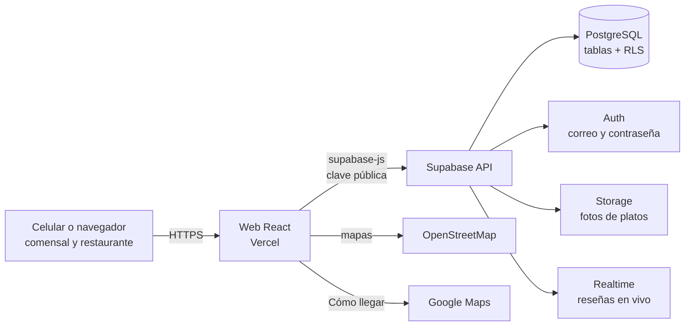

# Fase 6. Desarrollo del MVP

El MVP implementa los requisitos **M** (debe tener) de la [Fase 5](05-ingenieria-de-requisitos.md#59-resumen-de-priorización). El código está en la carpeta [`mvp/`](../mvp/) y las instrucciones para ejecutarlo en [`mvp/README.md`](../mvp/README.md).

## 6.1 Arquitectura TIC

| Componente | Tecnología | Por qué | Costo |
|---|---|---|---|
| Frontend (web para celular) | React 19 + Vite | Estándar actual, arranque rápido, componentes reutilizables | Gratis |
| Estilos | Tailwind CSS 4 | Diseño responsive desde el celular con la paleta "Vino y ají" | Gratis |
| Base de datos | Supabase (PostgreSQL) | Base de datos real con seguridad por filas (RLS) sin programar un servidor | Plan Free |
| Autenticación | Supabase Auth (correo y contraseña) | Login listo y seguro | Plan Free |
| Fotos | Supabase Storage | Cada usuario sube solo a su carpeta; las fotos se comprimen a WebP | Plan Free (1 GB) |
| Tiempo real | Supabase Realtime | Las reseñas nuevas aparecen al instante en la ficha del plato | Plan Free |
| Mapas | Leaflet + OpenStreetMap | Mapas gratis sin tarjeta de crédito | Gratis |
| Cómo llegar | Enlace a Google Maps | Abre la app de mapas del celular | Gratis |
| Código QR | Librería `qrcode` | Genera el QR de cada local en el navegador | Gratis |
| Gráficos | Chart.js | Estadísticas del restaurante | Gratis |
| PWA | Manifiesto + service worker mínimo | Se instala en el celular como una app, sin pasar por la tienda. No funciona sin conexión (decisión del equipo) | Gratis |
| Publicación | Vercel | Link público para la demo | Gratis |

**Seguridad aplicada:**
- Todas las tablas tienen **RLS** (seguridad por filas): cada restaurante solo edita lo suyo y cada persona solo edita sus reseñas.
- **El dueño no puede borrar reseñas** (RN-06).
- **El código del QR es secreto:** está en una tabla que solo ve el dueño. La verificación la hace la base de datos, no el navegador, así que nadie puede marcar su reseña como verificada sin estar en el local.
- El navegador solo usa la **clave pública** (*publishable key*).

## 6.2 Estructura del código

| Carpeta | Contenido |
|---|---|
| `mvp/supabase/01_esquema.sql` | Tablas, seguridad, vista del ranking, fotos y tiempo real |
| `mvp/supabase/02_datos_ejemplo.sql` | 24 locales, 60 platos y unas 600 reseñas de ejemplo en Tarija |
| `mvp/src/pages/` | Pantallas del comensal: inicio y búsqueda, plato, restaurante, ingresar |
| `mvp/src/panel/` | Panel del restaurante: platos, reseñas, estadísticas, QR y datos del local |
| `mvp/src/components/` | Piezas reutilizables: sello de calificación, tarjeta de plato, estrellas, mapa |
| `mvp/src/lib/` | Conexión a Supabase, distancias, formatos, fotos, QR y eventos |

## 6.3 Requisitos implementados

| Requisito | Dónde | Estado |
|---|---|---|
| RF-01 Buscar por plato o antojo | Inicio (búsqueda por nombre, categoría y sinónimos) | ✅ |
| RF-02 Ranking calificación + precio | Vista `platos_ranking` (RN-04) | ✅ |
| RF-03 Filtros de precio y distancia | Inicio | ✅ |
| RF-04 Filtro "Abierto ahora" | Inicio | ✅ (era S) |
| RF-05 Resultado con distancia, precio y calificación | Tarjeta de plato | ✅ |
| RF-07 Ficha del plato | Página del plato | ✅ |
| RF-08 Cómo llegar | Página del plato y del restaurante | ✅ |
| RF-09 Pedir en PedidosYa / Yango | Botón "Pedir a domicilio" si el local cargó su enlace | ✅ (era S) |
| RF-10 Perfil y menú del restaurante | Página del restaurante con mapa | ✅ |
| RF-11 Registro e ingreso | Ingresar (correo y contraseña) | ✅ |
| RF-12 Calificar con comentario y foto | Formulario de reseña | ✅ |
| RF-13 Reseña verificada con QR | QR → página del local → reseña verificada por la base de datos | ✅ |
| RF-17 Registrar el local | Panel → Registrar un restaurante (con mapa) | ✅ |
| RF-18 Gestionar platos | Panel → Platos (con foto y límite por plan) | ✅ |
| RF-19 Responder reseñas | Panel → Reseñas | ✅ |
| RF-20 Generar QR | Panel → Código QR (imprimir o descargar) | ✅ |
| RF-21 Estadísticas | Panel → Estadísticas (vistas, cómo llegar, lo más buscado) | ✅ |
| RF-24 Enlace de delivery | Panel → Datos del local | ✅ (era S) |
| RNF-03 Pensada para celular e instalable | PWA con ícono, pantalla completa y botón "Instalar" (en iPhone, instrucciones) | ✅ |
| RF-25 Carga de locales por el equipo | Datos de ejemplo + rol administrador | ✅ |
| RF-14 / RF-15 Puntos y canjes | — | ⏳ Siguiente versión |

## 6.4 Pruebas

| Prueba | Resultado |
|---|---|
| El esquema y los datos se ejecutan sin errores (Postgres local de prueba) | ✅ |
| Un visitante puede leer el ranking pero no puede ver los códigos QR | ✅ |
| Una reseña con el QR correcto queda verificada; con el QR de otro local, no | ✅ |
| Un cliente no puede editar platos ajenos ni responder reseñas | ✅ |
| Un dueño no puede borrar reseñas ni agregar platos a otro local | ✅ |
| Al cambiar el precio se actualiza la fecha (RN-05) | ✅ |
| Al registrar un local se crea su código QR automáticamente | ✅ |
| Pruebas de las historias de usuario en el proyecto real | `[PENDIENTE]` |

## 6.5 Pitch y demo

Cada integrante tiene **1 minuto de pitch y 1 minuto de demo**. Las presentaciones están dentro de la app, en `/pitch`:

| Presentación | Ruta | A quién le vende | La demo empieza en |
|---|---|---|---|
| Alberto | `/pitch/alberto` | Dueño de restaurante (quien paga) | Panel del restaurante (`/panel`) |
| Cecilia | `/pitch/cecilia` | Comensal (quien usa la app) | Buscador (`/`) |

Estructura de venta de cada pitch (60 s): gancho (10 s) → problema con datos (12 s) → solución y beneficios (15 s) → por qué Antojo (10 s) → prueba, oferta y llamado a la acción (13 s). Al presionar → en la última diapositiva se abre la app y aparece un cronómetro flotante con el minuto de demo.

**Demo de Alberto (restaurante):** Mi restaurante → Burger Lab → estadísticas → responder una reseña → editar un plato → código QR.

**Demo de Cecilia (comensal):** buscar "hamburguesa" → filtros → abrir el primer plato → reseñas verificadas → "Cómo llegar" → dejar una reseña → instalar la app.

Los guiones hablados están en las notas de cada diapositiva (tecla N).

---

[← Índice](README.md) · [← Fase 5. Ingeniería de requisitos](05-ingenieria-de-requisitos.md) · [Fase 7. Escalabilidad →](07-escalabilidad.md)
